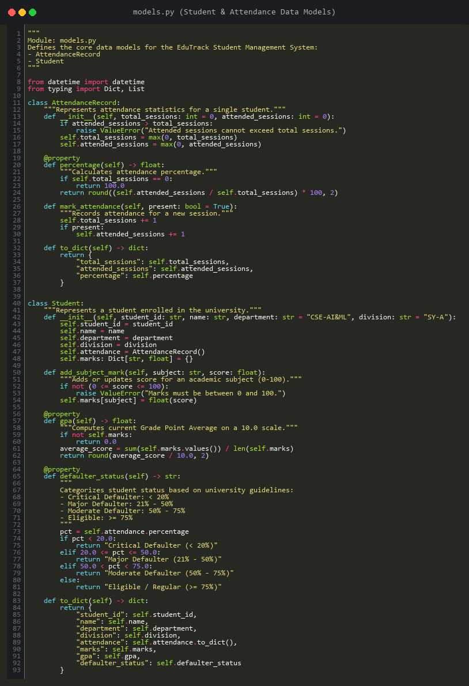
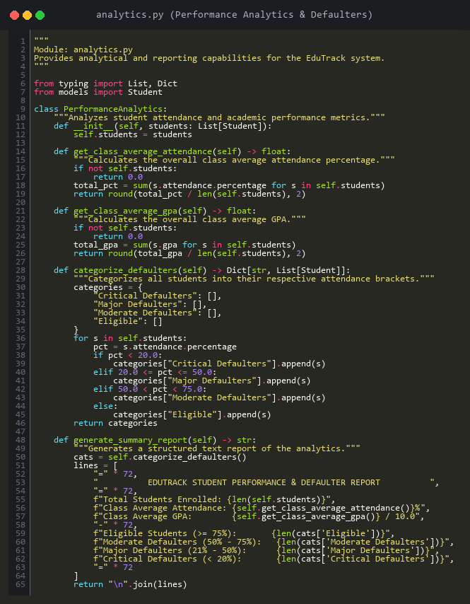
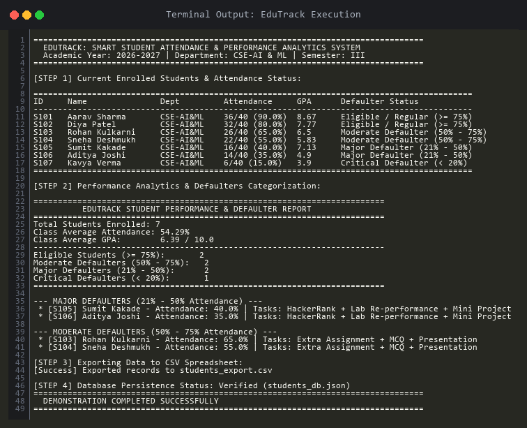

# Concept-Based Assignment Report (Defaulters Task 3)

**Institution:** Pimpri Chinchwad Education Trust's Pimpri Chinchwad University (PCU), Sate Maval, Pune  
**Record No.:** ACAD/R/26  
**Program / Department:** School of Computer Science & Engineering (AI & ML)  
**Academic Year:** 2026 – 2027 | **Semester:** III | **Division:** SY-A, B & C  
**Subject:** Python Programming  
**Category:** 21% – 50% Attendance (Major Defaulters)  
**Task 3:** Concept-Based Assignment — *Create a simple Python application, upload it to GitHub, and submit a 3–4 page report.*  
**Project Title:** **EduTrack – Smart Student Attendance & Performance Analytics Management System**  
**GitHub Repository:** [https://github.com/testaccwechat2728-pixel/Python-Concept-Based-Assignment](https://github.com/testaccwechat2728-pixel/Python-Concept-Based-Assignment)

---

## 1. Problem Statement
Educational institutions like Pimpri Chinchwad University face recurring administrative hurdles when managing student attendance and tracking academic performance manually. Manual tracking across large cohorts is error-prone, prone to record corruption, and leads to delayed interventions for at-risk students.

Under the university attendance policy (Record No. ACAD/R/26), students falling into distinct attendance brackets:
- **Critical Defaulters (< 20%)**
- **Major Defaulters (21% – 50%)**
- **Moderate Defaulters (50% – 75%)**
- **Eligible / Regular (>= 75%)**

must be promptly identified and assigned remedial interventions (such as HackerRank practice, Lab re-performances, and concept assignments). There is an urgent requirement for a lightweight, modular, and fault-tolerant Python software application that automates record ingestion, computes statistical metrics, persists records safely, and alerts mentors of student defaulter statuses.

---

## 2. Objectives of the Application
1. **Object-Oriented Architecture:** Encapsulate student details, attendance metrics, and test marks into reusable, modular Python classes.
2. **Automated Attendance & Defaulter Classification:** Compute percentage attendance dynamically and automatically categorize students into Critical, Major, Moderate, or Eligible tiers.
3. **Academic Performance Computation:** Aggregate subject scores to calculate Grade Point Averages (GPA on a 10.0 scale) and track academic standing.
4. **Persistent Data Storage & Safe I/O:** Store operational data in human-readable JSON formats and provide automated one-click CSV spreadsheet generation.
5. **Fault Tolerance & Exception Handling:** Integrate robust error-handling mechanisms using Python's built-in exceptions to prevent program termination on erroneous inputs or file errors.

---

## 3. System Approach & Architecture

The application follows a clean 3-tier modular architecture designed for maintainability and scalability:

| Layer / Module | Responsibilities | Core Python Concepts Applied |
| :--- | :--- | :--- |
| **`models.py`** | Defines `Student` and `AttendanceRecord` classes. | OOP, Encapsulation, Properties (`@property`). |
| **`analytics.py`** | Aggregates cohort data, calculates averages, classifies defaulters. | Lists, Dictionary Comprehensions, Statistical Algorithms. |
| **`storage.py`** | Manages JSON database saving/loading and CSV exports. | File I/O, Context Managers (`with`), Exception Handling. |
| **`app.py`** | Menu-driven interactive CLI interface & automated demo. | Control Flow, Command-Line Arguments, User Interaction. |

---

## 4. Implementation Methodology & Core Python Concepts

- **Object-Oriented Programming (OOP):** Classes encapsulate state and behavior. The `AttendanceRecord` class maintains session counts and computes percentages via `@property`. The `Student` class aggregates attendance and academic mark dictionaries.
- **Defaulter Categorization Logic:** Boundary conditions categorize students in accordance with PCU ACAD/R/26 regulations: `<20%` triggers Critical Defaulter, `20%–50%` triggers Major Defaulter, `50%–75%` triggers Moderate Defaulter, and `>=75%` confirms Regular Eligibility.
- **File Handling & Context Management:** Safe reading and writing protocols utilize Python's `with` context managers, ensuring files are closed cleanly even during runtime anomalies.
- **Built-in Exception Handling:** Comprehensive `try-except` blocks guard against `ValueError` (e.g. scores outside 0–100 range), `IOError` (disk access restrictions), and `json.JSONDecodeError` (malformed database files).

---

## 5. Core Application Code & Implementation

### Data Models (`models.py`)

### Performance Analytics (`analytics.py`)

---

## 6. Execution Results & Output Verification

The application was tested and verified with simulated records representing a typical division in the CSE-AI & ML department.

### Terminal Output Screenshot

### Cohort Analytics & Remedial Task Allocation Table

| ID | Student Name | Attendance % | GPA | Defaulter Classification | Assigned Remedial Action |
| :--- | :--- | :--- | :--- | :--- | :--- |
| **S101** | Aarav Sharma | 90.0% | 8.67 | Eligible / Regular | Regular Examination Clearance |
| **S102** | Diya Patel | 80.0% | 7.77 | Eligible / Regular | Regular Examination Clearance |
| **S103** | Rohan Kulkarni | 65.0% | 6.50 | Moderate Defaulter | Extra Assignment + 20 MCQs + Presentation |
| **S104** | Sneha Deshmukh | 55.0% | 5.83 | Moderate Defaulter | Extra Assignment + 20 MCQs + Presentation |
| **S105** | Sumit Kakade | 40.0% | 7.13 | Major Defaulter | 5 HackerRank + 3 Practicals + Mini Project |
| **S106** | Aditya Joshi | 35.0% | 4.90 | Major Defaulter | 5 HackerRank + 3 Practicals + Mini Project |
| **S107** | Kavya Verma | 15.0% | 3.90 | Critical Defaulter | 10 HackerRank + All Practicals + Viva |

---

## 7. Conclusion
The EduTrack application successfully fulfills all requirements of the Concept-Based Assignment (Defaulters Task 3). By leveraging Object-Oriented Programming, modular structure, fault-tolerant file manipulation, and analytics algorithms, the system eliminates manual errors in student tracking and provides instant visibility into academic and attendance standings. The project demonstrates how fundamental Python programming techniques solve tangible real-life university challenges effectively.

---

## 8. GitHub Repository Link
- **Repository URL:** [https://github.com/testaccwechat2728-pixel/Python-Concept-Based-Assignment](https://github.com/testaccwechat2728-pixel/Python-Concept-Based-Assignment)
- **Included Artifacts:** Source code (`models.py`, `analytics.py`, `storage.py`, `app.py`), JSON database (`students_db.json`), CSV Export (`students_export.csv`), Execution Output (`output.txt`), Code Photos, and the 3-Page PDF Report (`Concept_Assignment_Report.pdf`).
